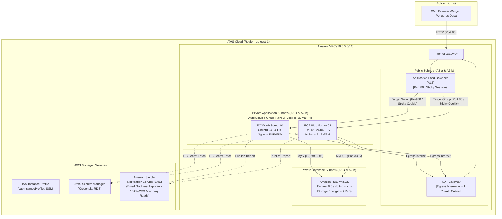

# terraform-ansible-automated-lab

Implementasi **Infrastructure as Code (IaC)** dan **Manajemen Konfigurasi Otomatis** untuk Platform Koperasi Desa (**KopDes**) Merah Putih menggunakan **HashiCorp Terraform** dan **Ansible** di **Amazon Web Services (AWS)**.

Repository ini bertugas menyediakan seluruh infrastruktur cloud AWS Native, jaringan, perizinan keamanan, database terkelola, load balancer, serta konfigurasi server web otomatis.

---

## Hubungan Antar Repository

Proyek KopDes Merah Putih menggunakan arsitektur pemisahan *Separation of Concerns*:

1. **Repository IaC (Repository Ini)**:  
   [`https://github.com/fendyramadhani9-cloud/terraform-ansible-automated-lab`](https://github.com/fendyramadhani9-cloud/terraform-ansible-automated-lab)  
   Berisi seluruh kode deklarasi infrastruktur Terraform dan playbook Ansible untuk Ubuntu 24.04 LTS.

2. **Repository Web Application**:  
   [`https://github.com/fendyramadhani9-cloud/kopdes-landingPAGE`](https://github.com/fendyramadhani9-cloud/kopdes-landingPAGE)  
   Berisi murni kode aplikasi web KopDes (PHP 8, HTML, CSS, JavaScript, SQLite/MySQL schema & seed).  
   *Repository ini akan otomatis di-clone oleh instance EC2 saat proses bootstrap berjalan.*

---

## Arsitektur AWS Native Target



---

## Komponen Infrastruktur

| Resource | Deskripsi & Konfigurasi |
| :--- | :--- |
| **VPC & Subnets** | CIDR `10.0.0.0/16` membentang di 2 AZ dengan 2 Public Subnet, 2 Private App Subnet, dan 2 Private DB Subnet. |
| **NAT Gateway** | 1 NAT Gateway di Public Subnet AZ-a (efisiensi biaya & sesuai kuota 1 EIP AWS Academy). |
| **Security Groups** | ALB SG (Port 80) $\rightarrow$ EC2 SG (Port 80 dari ALB) $\rightarrow$ RDS SG (Port 3306 dari EC2). |
| **Load Balancer** | Application Load Balancer dengan Target Group `/index.php?page=login` dan stickiness `lb_cookie` 86400 detik. |
| **Compute (ASG)** | Launch Template Ubuntu 24.04 LTS (Noble Numbat), instance type `t3.micro`, kapasitas 2 s.d. 4 instance. |
| **Database (RDS)** | Amazon RDS MySQL 8.0 (`db.t4g.micro`), backup 7 hari, KMS encryption, single-AZ default. |
| **Secrets Manager** | Menyimpan password master database secara acak tanpa hardcoded string di source code. |
| **IAM Profile** | Mendukung `LabInstanceProfile` AWS Academy Learner Lab dan AWS Systems Manager ke EC2. |
| **Amazon SNS** | Topik notifikasi rekapitulasi laporan ekonomi dan email subscription (didukung penuh di AWS Academy). |

---

## Alur Self-Healing & Bootstrap Instance

Setiap instance baru yang diluncurkan oleh Auto Scaling Group menjalankan skrip `terraform/user_data.sh.tftpl`:
1. Menginstal dependensi OS: `git`, `python3`, `pip`, `jq`, `awscli`.
2. Menginstal `ansible-core`.
3. Meng-clone repository IaC ini ke `/opt/kopdes-iac`.
4. Meng-clone repository Web App (`kopdes-landingPAGE`) ke `/var/www/kopdes`.
5. Menjalankan playbook Ansible secara lokal:
   ```bash
   ansible-playbook -i "localhost," -c local /opt/kopdes-iac/ansible/playbook_app.yml ...
   ```
6. Mengonfigurasi Nginx, PHP-FPM, dan template `.env` agar node web siap melayani trafik dari Application Load Balancer secara murni *stateless*.

---

## Struktur Direktori Repository

```text
terraform-ansible-automated-lab/
|-- terraform/                         # Deklarasi Infrastruktur Cloud (AWS)
|   |-- versions.tf                    # Provider AWS (~> 5.0) dan Random (~> 3.6)
|   |-- variables.tf                   # Definisi variabel VPC, ASG, RDS, SNS, Repo URLs
|   |-- terraform.tfvars.example       # Template variabel deployment
|   |-- terraform.tfvars               # Nilai variabel aktif
|   |-- main.tf                        # Resource VPC, ALB, ASG, RDS, IAM, Secrets Manager, SNS
|   |-- outputs.tf                     # Output aman (alb_dns_name, rds_endpoint, sns_topic_arn)
|   `-- user_data.sh.tftpl             # Script bootstrap cloud-init EC2 (Ansible runner)
|
|-- ansible/                           # Manajemen Konfigurasi (Ubuntu 24.04 LTS)
|   |-- ansible.cfg                    # Konfigurasi interpreter & user ubuntu
|   |-- inventory.ini                  # Template inventory host EC2
|   |-- generate_inventory_aws.sh      # Skrip dinamis query EC2 via AWS CLI
|   |-- aws_ec2.yml                    # Plugin konfigurasi dynamic inventory AWS
|   |-- group_vars/
|   |   `-- all.yml                    # Variabel konfigurasi AWS, RDS, ALB, SNS
|   |-- playbook_app.yml               # Playbook bootstrap mandiri untuk user_data ASG
|   |-- site.yml                       # Master playbook multi-node orchestration
|   `-- roles/
|       |-- common/                    # Baseline Ubuntu 24.04 (apt update, curl, git)
|       |-- webserver/                 # Nginx, PHP-FPM, virtual host, deployment kode
|       `-- database/                  # Inisialisasi schema & seed ke Amazon RDS
|
|-- TUTORIAL.md                        # Panduan deployment lengkap langkah-demi-langkah
|-- .gitignore                         # Mengabaikan file state dan cache terraform
`-- README.md                          # Dokumentasi arsitektur IaC (file ini)
```

---

## Panduan Menjalankan

Panduan lengkap langkah-demi-langkah mulai dari instalasi AWS CLI v2, setup kredensial AWS Academy Learner Lab, konfigurasi key pair `vockey`, deployment Terraform, hingga pengujian aplikasi dapat dibaca di:
👉 **[TUTORIAL.md](./TUTORIAL.md)**

### Ringkasan Cepat:
1. **Set Kredensial AWS Academy**:
   ```bash
   export AWS_ACCESS_KEY_ID="ASIAxxxxxxxx"
   export AWS_SECRET_ACCESS_KEY="xxxxxxxx"
   export AWS_SESSION_TOKEN="IQoJb3JpZ2lu..."
   export AWS_DEFAULT_REGION="us-east-1"
   ```
2. **Provisioning Infrastruktur**:
   ```bash
   cd terraform
   cp terraform.tfvars.example terraform.tfvars
   terraform init
   terraform apply
   ```
3. **Pembersihan Resource (Teardown)**:
   ```bash
   cd terraform
   terraform destroy
   ```
